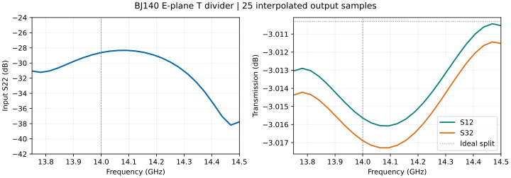

# HFSS E-T 功分器 Skill

用于 HFSS 矩形波导 E 面 T 形二路功分器的检查、双膜片匹配和结果审核。输入反射、开口宽度、单侧深入、膜片厚度、位置和两路相位集中在同一个技能中。

本仓库仅维护 **`hfss-et-divider`**。圆波导 TE₀₁ 弯头、模式转换器和定向耦合器仍在 [TE₀₁ 技能合集](https://github.com/shao36058-png/skills)。

[技能入口](SKILL.md) · [BJ140 完整参数](references/bj140-14ghz.md) · [AEDT 操作流程](references/aedt-workflow.md) · [MIT 许可证](LICENSE)

## 安装与使用

使用 [skills CLI](https://github.com/vercel-labs/skills)，为 Codex 安装：

```bash
npx skills add https://github.com/shao36058-png/-skills --skill hfss-et-divider --agent codex
```

在助手中输入：

```text
使用 $hfss-et-divider 检查当前 HFSS E-T 功分器。
工作频段 13.75–14.5 GHz，BJ140 截面 15.80 × 7.90 mm。
先核对当前端口、膜片参数和已有结果，再优化输入反射。
直接修改当前工程，不建立副本，保持现有求解精度。
```

原位修改或另建工作副本由当前任务决定，技能遵从用户选择。实际连接和求解需要可用的 HFSS / AEDT 自动化环境；离线审核只需要 Python 3.10+，使用标准库。

## BJ140：13.75–14.5 GHz 案例

波导截面 **15.80 × 7.90 mm**，横臂总长 **60 mm**，输入支路从 T 结外壁到端口 **30 mm**。膜片左右对称伸入宽边方向，开口高度为 7.90 mm。

| 参数 / mm | 第一片 | 第二片 |
|---|---:|---:|
| 开口全宽 | 7.800 | 10.150 |
| 每侧深入长度 | 4.000 | 2.825 |
| 中心距 T 结外壁 | 4.230 | 14.550 |
| 沿传播方向厚度 | 0.250 | 0.250 |

| 指标 | 保存结果 |
|---|---:|
| 全带输出样点中最差输入 S22 | −28.33 dB |
| 最大反射功率 | 0.147% |
| 14 GHz 处输入 S22 | −28.62 dB |
| 14 GHz 两路传输 S12 / S32 | −3.0156 / −3.0169 dB |
| 最大两路幅度差 | 0.00133 dB |
| 相对 180° 的最大相位误差 | 0.03682° |



本例修正了“换成 BJ140 截面及 14 GHz 频段后，仍沿用原 24 GHz 膜片尺寸”的强失配。沿用 ΔS=0.005 的网格收敛要求，实际完成 11 次自适应迭代，最后 ΔS=0.0026741；原生求解和插值扫频均正常完成。详细定义与证据范围见 [BJ140 案例](references/bj140-14ghz.md)。

这些结果来自**空气 / PEC 模型的 25 个插值输出样点**，不是 25 次独立离散求解，也不构成真实铜件的连续功率额定值。两路每路约 −3.01 dB 对应等分，输出在一致端口极性下相差约 180°。

## 离线复核

克隆或下载仓库后，在仓库根目录运行：

```bash
python scripts/divider_metrics.py --input assets/bj140-14ghz-case.json --max-reflection-db -25 --min-frequency-ghz 13.75 --max-frequency-ghz 14.5
```

脚本从原始复数 S 参数重新计算反射、两路传输、幅差、相位误差和三项功率残余，并派生完整膜片尺寸。它不会连接 AEDT 或触发求解。更换端口编号时使用 `--reflection-expression` 和 `--output-expressions`。

同时保留 [23–25 GHz 的原案例](references/et-design.md)及 [21 点复数数据](assets/reference-case.json)：

```bash
python scripts/divider_metrics.py --input assets/reference-case.json --max-reflection-db -25 --min-frequency-ghz 23 --max-frequency-ghz 25
```

两个案例的尺寸和结果分别对应各自截面与频带；复制尺寸到新工程后仍需检查实际几何及求解结果。参考环境为 HFSS 2025 R2 / PyAEDT 1.1.0。

## 内容与分发

- `SKILL.md`：技能入口与任务判断。
- `references/`：几何定义、两个频段案例及 AEDT 操作经验。
- `scripts/divider_metrics.py`：标准库离线指标审核。
- `assets/`：可复核的原始复数案例数据。

技能包含流程、参数和数据，不分发引用论文全文或 HFSS 二进制工程。市场展示取决于平台索引；本仓库发布本身不表示已被市场收录。许可采用 [MIT](LICENSE)。

**English:** A single Agent Skill for HFSS rectangular-waveguide E-plane T dividers: symmetric iris matching, complete dimensions, saved complex-S audits, and port phase checks. Includes a BJ140 13.75–14.5 GHz PEC case and a separate 23–25 GHz reference.
