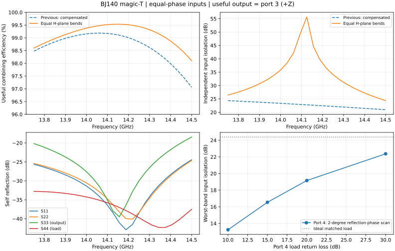

# BJ140 四端口魔 T：等长 H 面馈电，无补偿

这是 2026-10-29 保留的名义电磁方案。四个外接口均 BJ140 15.8 × 7.9 mm，工作频段 13.75–14.5 GHz。两输入各 0.5 W、均 0°；3 号和端口沿 +Z 输出，4 号差端口沿 +Y，仿真保留 0 W 波端口代表理想匹配负载。

原输入 1 的 14.343951 mm 额外补偿段已删除。输入馈电从原来的 E 面弯头布局改成 XZ 平面内互为镜像的等长 H 面弯头，两个输入端口的 TE10 积分线都沿 +Y。此处物理路径和法兰方位发生了变化，没有用翻转积分线、去嵌或给一源加 180° 来制造同相合成。



## 端口与坐标

全局 X 是两个输入的对称方向，Z 为有效输出，Y 为差模负载。长度单位均为 mm，原点为结区中心。

| 端口 | 模态角色 | 面中心 (X,Y,Z) | TE10 积分线方向 |
|---|---|---|---|
| 1 | 输入 | (−22.417954, 0, −30) | +Y |
| 2 | 输入 | (+22.417954, 0, −30) | +Y |
| 3 | 和输出 | (0, 0, 32.9) | +Y |
| 4 | 差模负载 | (0, 33.95, 0) | +X |

积分线位于各自端口面，未去嵌、未重新归一化。端口 4 并非金属盖板；实物需要匹配假负载。端口编号和轴向仅用于复现此案例。

## 完整名义参数

| 参数 | 值 / mm | 定义 |
|---|---:|---|
| a / b | 15.8 / 7.9 | 外接口宽边 / 窄边 |
| half_sep | 22.417954 | 输入中心距的一半；总间距 44.835908 |
| feed_len | 30 | 输入端口到结区 Z=0 的距离 |
| sum_len | 30 | **历史名称**：实际是 Y 差模负载臂，从 y=b/2 起 |
| diff_len | 25 | **历史名称**：实际是 Z 和输出臂，从 z=a/2 起 |
| bend_miter | 11.982475 | H 面弯头切角的直角边长 |
| phase_extra | 0 | 额外输入路径补偿，已取消 |
| base_r | 7.7452957 | 沿 Y 匹配体底座半径 |
| base_h | 1.35 | 底座轴向厚度 |
| cone_h | 2.9135204 | 圆台轴向长度 |
| stem_r | 0.578755 | 细柱与半球顶半径 |
| stem_h | 9.1612244 | 圆台顶到半球尖的总长度 |
| iris_w | 15.65 | Y 臂沿 Z 宽边的膜片开口 |
| iris_d | 2.61722 | Y 膜片中心距结区外壁 y=b/2 |
| iris_t | 0.289377 | Y 膜片沿 Y 的厚度 |
| z_iris_w | 11.9 | Z 臂沿 X 宽边的膜片开口 |
| z_iris_d | 5 | Z 膜片中心距结区外壁 z=a/2 |
| z_iris_t | 0.5 | Z 膜片沿 Z 的厚度 |

两种膜片均沿窄边贯穿 7.9 mm，开口、深入和位置是不同参数：

| 派生量 | Y 负载臂膜片 | Z 输出臂膜片 |
|---|---:|---:|
| 单侧深入 (a−w)/2 | 0.075 | 1.950 |
| 膜片中心全局坐标 | Y=6.567220 | Z=12.900000 |
| 近面距结区外壁 d−t/2 | 2.4725315 | 4.750000 |
| 远面距结区外壁 d+t/2 | 2.7619085 | 5.250000 |

匹配体从 y=−b/2=−3.95 处沿 +Y 生长，轴线 X=Z=0，依次为底座、圆台、细柱和半球顶。圆台从 `base_r` 缩到 `stem_r`；细柱圆柱段为 `stem_h−stem_r=8.5824694 mm`，半球另占一个半径。总体轴向长度 13.4247448 mm，尖端 Y=9.4747448 mm。

这是空气腔的负体积模型：匹配体和膜片从空气扣除，其表面施加铜壁，并不是敞向外界的孔。材料为常数电导率 5.8×10^7 S/m 的光滑铜壁和空气；未加入实际负载、粗糙度、装配缝隙或热反馈。

## 复建腔体的轮廓约定

令 `h=half_sep`、`m=bend_miter`、`f=feed_len`。主空气腔是 XZ 平面下列闭合轮廓，从 Y=−b/2 沿 +Y 拉伸 b：

```text
(-h-a/2, -f), (-h+a/2, -f), (-h+a/2, -a/2),
( h-a/2, -a/2), (h-a/2, -f), (h+a/2, -f),
( h+a/2, a/2-m), (h+a/2-m, a/2),
(-h-a/2+m, a/2), (-h-a/2, a/2-m)
```

并入 Y 臂空气盒：X 在 ±b/2、Z 在 ±a/2，Y 从 b/2 到 b/2+sum_len。并入 Z 臂空气盒：X 在 ±a/2、Y 在 ±b/2，Z 从 a/2 到 a/2+diff_len。随后扣除匹配体和两处对称膜片，再定义四个端口与全部闭合铜壁。不能仅复制旧变量名推断和/差角色。

## 与上一版补偿魔 T 比较

| 项目 | 旧 E 面馈电＋补偿 | 新等长 H 面馈电 |
|---|---:|---:|
| 输入额外路径 | 14.343951 mm | 0 |
| 全带样点合成效率 | 97.062–99.187% | 98.105–99.537% |
| 最差独立输入隔离 | 20.981 dB | 24.383 dB |

匹配体、切角和输出膜片也一起优化过；此表是两个完整版本的比较，不能把全部提升归因于删除补偿段。旧版参数见 [magic-t-compensated 数据](../assets/cases/magic-t-compensated.json)，新数据见 [magic-t-equal-h-bends](../assets/cases/magic-t-equal-h-bends.json)。

## 最终指标与负载依赖

| 全带输出样点指标 | 名义结果 |
|---|---:|
| P3/(P1_inc+P2_inc) | 98.104976–99.536532% |
| 最差独立输入隔离 | 24.383459 dB |
| 最差 S11 / S22 | −24.444007 / −24.635918 dB |
| 最差 S33 / S44 | −18.451292 / −32.781406 dB |
| 到 3 口两路径相位差最大绝对值 | 0.037849° |
| 两路径幅度差最大绝对值 | 0.029171 dB |
| 平衡输入时 P4 最大值，总输入 1 W | 2.72662×10^-6 W |
| 全通道功率残余，总输入 1 W | 0.004368–0.004807 W |

效率不是唯一完成条件：当前输出口反射**未达到全带 S33≤−20 dB**。残余包含损耗和数值误差，尚无独立热模型。

对第 4 口负载做网络缩并，在每个频率扫描反射相位（2° 步进）：

| 负载条件 | 最差输入隔离 / dB |
|---|---:|
| 理想匹配 | 24.3835 |
| 回波损耗 30 dB | 22.3697 |
| 回波损耗 20 dB | 19.1584 |
| 回波损耗 15 dB | 16.5410 |
| 回波损耗 10 dB | 13.2394 |
| 端口参考面直接短路 Gamma=−1 | 5.5908 |

这些是负载失配敏感性，不是某款负载的实测曲线。不同反射相位也不一定在同一频率达到各项极值。封口时正常效率仍可很高，输入隔离却显著恶化；不能用效率来证明负载可省。

## 求解与证据范围

沿用 14 GHz 单频自适应，DeltaS=0.02、最多 6 轮；13.75–14.5 GHz 插值扫频，25 个输出样点，插值容限 0.5%。25 点不是 25 次独立全波求解。入选结果核实正常收敛、完整 4×4 传播 TE10 的复数 S、互易和无源；最终只保留一个名义几何解，保存重开后复数 S 最大差为 0。

调参使用单任务、2 核、40% RAM 配置，监测最低可用内存约 15.22 GiB；本机保护阈值为启动前可用至少 8 GiB，运行时低于 5 GiB 或使用率超过 84% 停止。新机器需要按容量和其他任务调整阈值。

离线数据保留源文件相对名称和 SHA256，用于追溯提取快照；仓库不包含 .aedt 及其完整场解，离线审核不能重新证明全波收敛、装配公差或额定功率。未验证 1 kW 连续波、水冷散热、空气击穿及故障假负载容量。当前方案的高隔离以实际匹配差模负载为条件。
